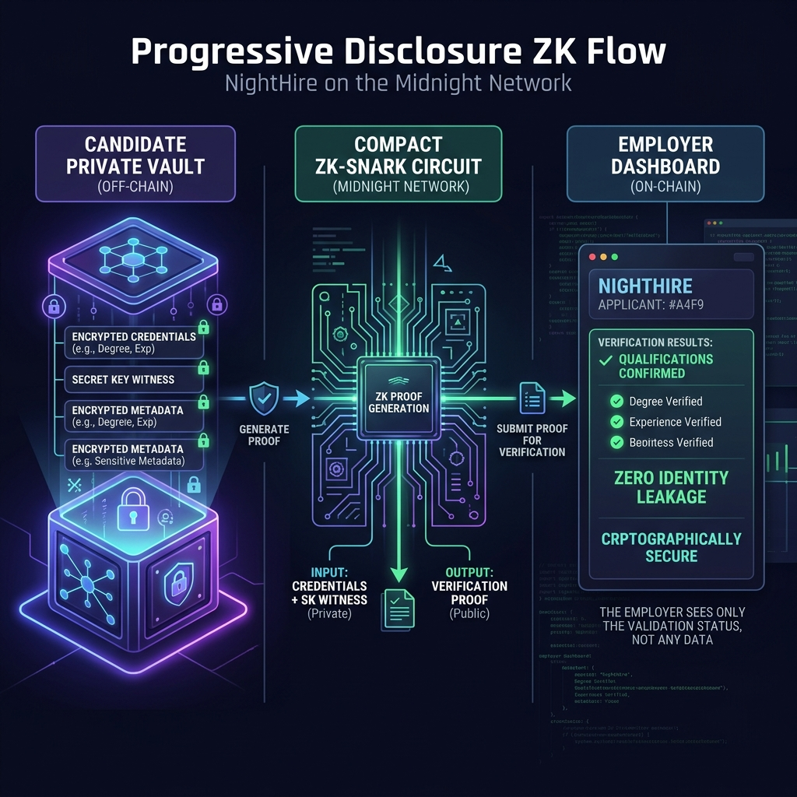

# 🛡️ NightHire — Privacy-Preserving Progressive Disclosure Hiring Protocol

**🌑 Demo:** *No live deployment. See [Quickstart](#-quickstart) for a 5-minute local setup, or `npm run dev` to start the frontend.*

<p align="center">
  
</p>

> **"Apply without your current employer finding out."**
> Prove you meet qualifications, experience thresholds, and verified ratings using **Midnight Zero-Knowledge Circuits** — without revealing your identity, employer name, or full history until **you** choose.

---

## Overview

Traditional job applications force candidates to leak their full identity, current employer, salary history, and personal contact info into arbitrary ATS databases **before** knowing if they are even shortlisted.

**NightHire** introduces **Progressive Disclosure** as a Midnight-native protocol:

1. **Screening (Zero PII disclosed)** — Candidates generate zero-knowledge proofs of registration, reputation thresholds, salary-band overlap, and jurisdiction matching. The Compact contract returns PASS/FAIL — never the underlying values.
2. **Mutual Shortlist (Selective identity disclosure)** — Once a candidate clears screening, the employer initiates a request; the candidate chooses which fields to reveal.
3. **Milestone Escrow** — Employers lock funds in `escrow.compact`; releases happen milestone-by-milestone with the candidate's privacy-preserving proof of work.

All three layers stay inside Midnight's **dual-ledger model**: aggregate counters and credential hashes live on the public ledger; per-candidate reputation, salary bands, jurisdictions, and escrow balances stay in private witnesses.

---

## 🚀 How to reproduce in 60 seconds

```bash
git clone https://github.com/Ryjen1/NightHire.git
cd NightHire
npm install --ignore-scripts
(cd boilerplate/contract && npm run compact)
(cd boilerplate/contract/src/wave2 && COMPACT_VERSION=0.31.1 ../../node_modules/.bin/compactc escrow.compact managed/escrow && ../../node_modules/.bin/zkir compile-many managed/escrow/zkir managed/escrow/keys)
npm test                              # 11 tests, no Docker required
npm run vendor                        # stage compiled contracts into the frontend
(cd frontend && npm install && npm run dev)   # http://localhost:5173
```

After running the local Quickstart, open [http://localhost:5173/](http://localhost:5173/) to use the full UI (Overview, Candidate, Authority, Employer, Escrow, Ledger, Source tabs).

### What you should see

1. **Overview** — three buttons (`Screening proof`, `Identity claim`, `Stage-3 escrow`) each run a real ZK proof in-browser via `compact-runtime`.
2. **Candidate** — 9 ZK-provable circuits; each generates a real proof using local witness state.
3. **Escrow** — `openEscrow` → `releaseMilestone` (×N) → `refundEscrow` walks the full state machine.
4. **Ledger** — public counters (`candidateCount`, `totalRatings`, `escrowCount`, …) reflect each circuit's ledger delta.

---

## 📐 Architecture & ZK Flow

<p align="center">
  
</p>

### Privacy primitives

| Circuit | Witness (private) | Public output | Privacy guarantee |
|---|---|---|---|
| `proveMinRating(threshold)` | `localRating` | threshold ≥ 4? | exact rating never leaks |
| `proveMinJobs(threshold)` | `localCompletedJobs` | count ≥ threshold? | exact count never leaks |
| `proveRegistered()` | `localSecretKey` | proof-token hash | registration proved without identity |
| `proveCredential(candidateCommitment)` | `localCredentialId`, `localCredentialSalt` | yes/no | credential id & salt stay private |
| `proveSalaryFits(jobLower, jobUpper)` | `localSalaryLower`, `localSalaryUpper` | fits / doesn't fit | salary band stays private |
| `proveJurisdiction(expectedHash)` | `localJurisdictionHash` | yes/no | jurisdiction name stays private |
| `releaseMilestone(escrowId, ...)` | `localMilestoneProof` | fund release | milestone index hidden from observers |

---

## 🔐 Smart Contract Surfaces

### `nighthire.compact` (9 export circuits, all provable)

| Circuit | Purpose |
|---|---|
| `register(commitment)` | Authority registers an anonymous candidate commitment on-chain |
| `issueCredential(candidateCommitment)` | Authority issues a Level-3 attestation; on-chain cell becomes `hash(commitment, credId, salt)` |
| `submitRating(candidateCommitment, rating)` | Public client submits a 1–5 milestone rating; aggregates update |
| `proveMinRating(threshold)` | Candidate ZK-proves accumulated rating ≥ threshold |
| `proveMinJobs(threshold)` | Candidate ZK-proves completed jobs ≥ threshold |
| `proveRegistered()` | Candidate ZK-proves membership in the registered set |
| `proveCredential(candidateCommitment)` | Candidate ZK-proves possession of a Level-3 attestation |
| `proveSalaryFits(jobLower, jobUpper)` | Candidate ZK-proves private salary band overlaps the job band |
| `proveJurisdiction(expectedCommitment)` | Candidate ZK-proves jurisdiction belongs to employer's allow-list |

**Ledger**: `authority`, `candidateCount`, `totalRatings`, `ratingSum`, `completedJobs`, `sequence`, `credentialAttestations: Map<Bytes<32>, Bytes<32>>`.

### `escrow.compact` (5 export circuits, all provable)

| Circuit | Purpose |
|---|---|
| `openEscrow(employer, candidate, amount, milestoneCount)` | Employer locks funds per pair; returns escrowId |
| `releaseMilestone(escrowId, milestoneAmount)` | Authority releases the next milestone; candidate's milestone index is a witness |
| `refundEscrow(escrowId)` | Authority refunds an unspent escrow |
| `proveEmployerLink(escrowId)` | Candidate ZK-proves knowledge of the employer commitment |
| `proveCandidateLink(escrowId)` | Employer ZK-proves knowledge of the candidate commitment |

**Ledger**: `escrowAuthority`, `escrowSequence`, `escrowCount`, `activeEscrowByPair: Map<Bytes<32>, Uint<64>>`, plus per-escrow state maps for `escrowAmount`, `escrowEmployer`, `escrowCandidate`, `escrowReleased`, `escrowMilestoneCount`, `escrowState`.

### Compile artifacts

Both contracts compile with `compactc 0.31.1 / language 0.23.0 / runtime 0.16.0`. Each exported circuit has both a `.prover` and `.verifier` artifact (regenerated with `zkir compile-many`). All 14 circuit prover+verifier pairs sit under `boilerplate/contract/src/managed/nighthire/keys/` and `boilerplate/contract/src/wave2/managed/escrow/keys/`.

### Private-state management

- `boilerplate/contract/src/witnesses.ts` is a typed discriminated union: `AuthorityPrivateState { adminKey }` and `CandidatePrivateState { secretKey, rating, completedJobs, credentialId, credentialSalt, salaryLower, salaryUpper, jurisdictionHash }`. Every witness implementation narrows on `privateState.role` and throws on cross-role access.
- `frontend/src/services/nightHire.ts` mirrors the same shape for browser-side execution. Private state is generated with `crypto.getRandomValues` and persisted in `localStorage` under `nighthire.private-state.v1`.
- Two instantiations of `Contract` are used in tests: one with the authority key, one with the candidate state. The same `witnesses` object backs both contracts.

### Tests

- `boilerplate/contract-cli/src/test/nighthire.unit.test.ts`: **11 tests pass without Docker.** Includes 6 source-level regression-guard invariants against a known bug class (no-op threshold proofs, single-direction salary overlap, single-key `issueCredential`, proof-skip on circuits without ledger writes, `proof:true` flag in `contract-info.json`).
- `@slow` integration suite (`test/commons.ts`) spins up a Midnight standalone node via Docker and exercises every circuit end-to-end. Reproduce with `npm run test-api` (requires Docker).

### Honest caveats

- **`escrow.compact` is a ledger-only state machine**, not a Zswap-wired DUST movement. The in-contract header at `escrow.compact:104-105` is explicit about this. Wiring Zswap into the existing state machine is the first post-v1 milestone; the contract shape leaves room for it without a redeploy.
- **No live testnet deployment is captured in this repository.** The boot script is in `boilerplate/contract-cli/src/api.ts` (`WalletBuilder.native()` + `httpClientProofProvider`); capturing a deployment tx hash is on the production-harden roadmap.

---

## 📁 Repository Structure

```text
nighthire/
├── assets/                          # Branding (logo, banner, architecture diagram)
├── LICENSE                          # Apache-2.0
├── README.md
├── nighthire.compact                # Mirrored root copy used to compile into contract/src
├── boilerplate/
│   ├── contract/                    # @midnight-ntwrk/contract workspace
│   │   └── src/
│   │       ├── nighthire.compact    # Reputation + credentials contract (9 circuits, proof:true)
│   │       ├── wave2/escrow.compact # Milestone escrow contract (5 circuits, proof:true)
│   │       ├── witnesses.ts         # Witness providers for all 14 circuits
│   │       ├── index.ts             # Exports `contracts = { NightHire }`
│   │       └── managed/             # Compiled ZKIR, prover/verifier keys
│   └── contract-cli/                # @midnight-ntwrk/contract-cli workspace
│       └── src/
│           ├── api.ts               # Standard Midnight.js wiring (deploy, call, ledger)
│           ├── common-types.ts      # NightHire-flavored providers, private-state types
│           └── test/
│               ├── commons.ts       # TestEnvironment (Docker compose)
│               └── nighthire.unit.test.ts # 11 tests, no Docker required
├── frontend/                        # React + Vite + TypeScript UI
│   └── src/
│       ├── App.tsx                  # Obsidian & Neon-Violet design system
│       └── index.css
├── archive/                         # Earlier contracts kept for reference, no longer compiled
│   └── wave-1-deprecated/
├── scripts/                         # vendor-frontend.mjs, deploy.mjs
└── plan.md                          # Product roadmap
```

---

## 🚀 Quickstart

### Prerequisites

- **Node.js ≥ 22.x** (we test on 22 and 24)
- **Compact toolchain ≥ 0.31.1** — install once: `npm i -g @midnight-ntwrk/compact-cli && compact update`
- **Docker Compose** (only required to run the full Docker-based test suite)

### 1. Install workspace deps

```bash
npm install --ignore-scripts
```

### 2. Compile both contracts

```bash
cd boilerplate/contract
npm run compact

# escrow (releases 5 circuits + zkir)
cd src/wave2
COMPACT_VERSION=0.31.1 ../../node_modules/.bin/compactc escrow.compact managed/escrow
../../node_modules/.bin/zkir compile-many managed/escrow/zkir managed/escrow/keys

cd ../../../..
```

### 3. Run the unit tests (no Docker needed)

```bash
cd boilerplate/contract-cli
npm test
```

You should see 11 passing tests covering:

- the contract module exposes all 9 exported circuits,
- all 9 witnesses are declared,
- every circuit has a real `.prover` + `.verifier` key,
- the `Contract` class is constructable with the witness set,
- 6 source-level negative-path invariants.

### 4. Run the integration tests (requires Docker)

```bash
cd boilerplate/contract-cli
docker compose -f standalone.yml pull
npm run test-api
```

This spins up a Midnight standalone node, deploys the contract, exercises every circuit, and tears down.

### 5. Launch the frontend

```bash
cd frontend
npm install
npm run dev
```

Open [http://localhost:5173/](http://localhost:5173/).

---

## 📜 License

Apache-2.0. See [LICENSE](./LICENSE) for the full text.

---

<p align="center">
  
</p>
